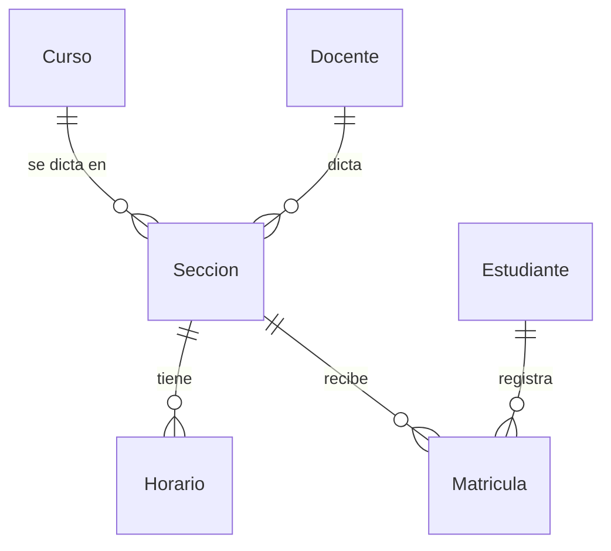

# Respaldo de la base de datos

Esta carpeta guarda la base de datos `UNI_Matricula` del proyecto, como exige la entrega final de la Semana 15:

- `UNI_Matricula.bak`: copia de seguridad completa, restaurable en SQL Server Management Studio.
- Scripts `.sql` para crear la base desde cero.

Si el `.bak` supera los 100 MB que admite GitHub, se reemplaza por un archivo `RUTA.txt` con el enlace de descarga.

## Crear la base desde cero

Ejecute los scripts en este orden. Cada uno se puede repetir sin error: solo crea o inserta lo que todavía no existe.

| Orden | Script | Qué hace |
|---|---|---|
| 1 | `01_crear_base.sql` | Crea la base `UNI_Matricula` y la tabla `Curso`. |
| 2 | `02_tablas_matricula.sql` | Crea las tablas `Docente`, `Estudiante`, `Seccion`, `Horario` y `Matricula`, con sus reglas de negocio. |
| 3 | `03_datos_ejemplo.sql` | Carga datos de ejemplo del periodo 2026-2: los mismos cursos y secciones del prototipo web, con personas ficticias. |
| 4 | `04_consultas.sql` | Prueba la matrícula con control de vacantes y ejecuta las consultas principales del sistema. |
| 5 | `05_usuarios.sql` | Crea la tabla `Usuario` para el inicio de sesión y cuatro usuarios de prueba, uno por rol. |

**Usuarios de prueba** (solo para la base de ejemplo): `admin`, `registros`, `jramos` (docente) y `20261001A` (estudiante), todos con la contraseña `Matricula2026`.

**En SQL Server Management Studio:** abra cada archivo con *File > Open > File* y ejecútelo completo con F5.

**Desde la terminal**, con autenticación de Windows y la instancia `SQLEXPRESS` (los scripts están en UTF-8):

```
sqlcmd -S .\SQLEXPRESS -E -C -I -f 65001 -i 01_crear_base.sql
```

Repita el comando con los otros tres scripts, en orden.

## Tablas y reglas



| Regla de negocio | Cómo la garantiza la base |
|---|---|
| Nunca hay sobrecupo (RF-01) | `CK_Seccion_vacantes`: las vacantes están siempre entre 0 y la capacidad. |
| Un estudiante no se matricula dos veces en la misma sección | Índice único `UX_Matricula_activa` sobre las matrículas activas. Una matrícula anulada no impide volver a matricularse. |
| Una matrícula anulada conserva su historial (RF-04) | `Matricula.estado` cambia a `ANULADA`; la fila no se borra. |
| No se repiten códigos ni correos | `UQ_Estudiante_codigo`, `UQ_Estudiante_correo`, `UQ_Docente_correo` y `UQ_Curso_codigo`. |
| Cada curso tiene una sola sección con la misma letra en un periodo | `UQ_Seccion_curso_periodo_letra`. |
| El código de estudiante tiene el formato UNI | `CK_Estudiante_codigo`: 8 dígitos y una letra. |
| Una clase termina después de empezar | `CK_Horario_horas`. |
| No se borra un curso que ya tiene secciones | Clave foránea `FK_Seccion_Curso`. |
| Ninguna contraseña se guarda (RNF-02) | `Usuario` guarda solo la sal y la derivación PBKDF2-HMAC-SHA256 de cada contraseña. |
